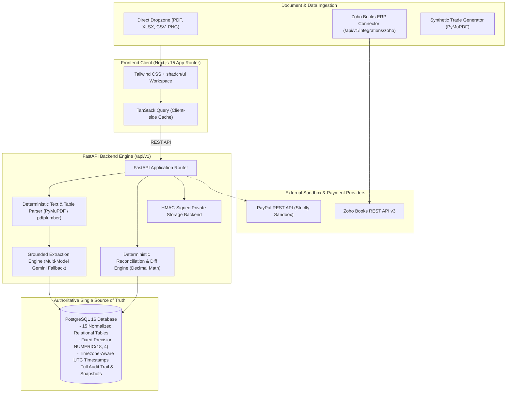

# ProcureMind
> **Autonomous Financial Reconciliation Engine & Cross-Border Trade Discrepancy Governance**

[](https://opensource.org/licenses/MIT)
[](https://fastapi.tiangolo.com)
[](https://nextjs.org)
[](https://www.postgresql.org)
[]()
[]()

---

## 1. Executive Summary & Value Proposition

Cross-border commercial trade is plagued by fragmented documentation, pricing discrepancies between proforma estimates and final commercial invoices, and disconnected payout ledgers. Manual audit teams spend hundreds of hours comparing line items, verifying customs filings, and reconciling bank payouts.

**ProcureMind** is an autonomous financial reconciliation engine designed to automate end-to-end multi-way reconciliation, cross-document variance detection, and governed disbursements:
- **Authoritative Ledger Integrity**: PostgreSQL 16 is the sole authority for all balances, trade states, and matching verdicts. All monetary arithmetic uses Python `Decimal` and SQL `NUMERIC(18, 4)`—never floating-point.
- **Cross-Document Variance Engine**: Side-by-side mathematical diffing between Proforma Invoices (estimates/quotations) and Commercial Invoices (final billing), surfacing unit-price creep and line-item variances before payment.
- **Direct ERP Document Ingestion (Zoho Books)**: Built-in OAuth 2.0 REST API v3 connector that automatically streams commercial invoices and official PDF copies directly into document storage with SHA-256 deduplication.
- **Grounded AI Extraction with Provenance**: Extracts headers, line items, and taxes with visual bounding-box provenance. Low-confidence extractions are flagged for human sign-off; auditors can record permanent field corrections with audit trail snapshots.
- **Governed PayPal Sandbox Disbursements**: Payments require explicit human auditor approval (`X-Auditor-Key`). Order amounts are strictly computed server-side from PostgreSQL, never accepted from the client.
- **Zero Autonomous Approvals**: Discrepancies and uncertain matches are flagged for human review. AI explains and assists; deterministic rules govern financial disbursements.

---

## 2. System Architecture



---

## 3. Monorepo Structure

```
ProcureMind/
├── backend/                  # FastAPI Application (Python 3.12+, SQLAlchemy 2.0, Alembic)
│   ├── app/
│   │   ├── api/v1/           # REST endpoints (documents, reconciliation, invoices, payments, zoho)
│   │   ├── core/             # Configuration, CORS, database engine, normalization
│   │   ├── models/           # SQLAlchemy domain models (export, payment, reconciliation, integration)
│   │   ├── schemas/          # Pydantic v2 schemas for all payloads & responses
│   │   ├── services/         # Extraction, reconciliation engine, zoho service, paypal service
│   │   ├── storage/          # Document storage abstraction (local disk / S3)
│   │   └── main.py           # FastAPI ASGI entrypoint
│   ├── migrations/           # Versioned Alembic migrations (0001 through 0006)
│   ├── tests/                # Automated pytest suite (115 tests)
│   ├── pyproject.toml        # uv / Python project metadata & dependencies
│   └── .env.example          # Backend environment template
├── frontend/                 # Next.js 15 App Router (TypeScript, Tailwind CSS, TanStack Query)
│   ├── app/
│   │   ├── documents/        # Document Registry & Grounded Bounding-Box Review (/review)
│   │   ├── reconciliation/   # Multi-way Reconciliation Queue & Cross-Document Diff Tool
│   │   ├── payments/         # Auditor Approval Gate & PayPal Sandbox Checkout
│   │   ├── integrations/     # Zoho Books ERP Connector & Live Simulation
│   │   ├── settings/         # System settings & auditor key configuration
│   │   └── page.tsx          # Executive dashboard & financial KPIs
│   ├── components/           # Reusable UI components & document diff visualizer
│   ├── lib/                  # Typed API client & session state
│   └── package.json          # Node dependencies (pnpm)
├── sample_documents/         # Authentic sample trade PDFs for evaluation (Proforma, Commercial, BL, Packing)
├── docker-compose.yml        # PostgreSQL service definition
├── LICENSE                   # Open Source MIT License
└── README.md                 # System overview and evaluation guide
```

---

## 4. 🚀 5-Minute Quick Start Guide for Judges

You can run ProcureMind locally using **Docker** for PostgreSQL, **uv** for the backend, and **pnpm** for the frontend.

### Prerequisites
- **Python 3.12+** (with `uv` recommended: `pip install uv`)
- **Node.js 18+** & **pnpm** (`npm install -g pnpm`)
- **Docker** (or an existing PostgreSQL 16 instance on port 5432)

---

### Step 1: Start PostgreSQL Database
```bash
docker compose up -d
```
*(This launches PostgreSQL 16 on `localhost:5432` with user `postgres`, password `postgres`, database `procuremind_dev`.)*

---

### Step 2: Start the Backend (FastAPI)
```bash
cd backend

# 1. Create your environment file from example
cp .env.example .env

# 2. Run database migrations to head
uv run alembic upgrade head

# 3. Start the FastAPI development server
uv run uvicorn app.main:app --reload --port 8000
```
- **Backend API**: `http://localhost:8000`
- **Swagger Interactive Docs**: `http://localhost:8000/api/v1/docs`
- **Health Check**: `http://localhost:8000/api/v1/health`

---

### Step 3: Start the Frontend (Next.js)
```bash
cd frontend

# 1. Install dependencies
pnpm install

# 2. Approve build scripts (for native modules)
pnpm approve-builds --all

# 3. Start Next.js development server
pnpm dev
```
- **Frontend Application**: `http://localhost:3000`

---

## 5. 🎯 Judge Evaluation Script (5-Minute Interactive Walkthrough)

To experience the full functionality of ProcureMind without needing any third-party credentials:

### 1. ⚡ Instant Zoho Books ERP Ingestion (Zero API Keys Needed)
1. Open [http://localhost:3000/integrations/zoho](http://localhost:3000/integrations/zoho).
2. Click the **"⚡ Simulate Zoho Import"** button in the top right.
3. **What happens**: The system generates a genuine digital vector PDF commercial invoice with itemized lines, computes its SHA-256 digest, stores it securely, runs structured extraction, and links it to an open export transaction in PostgreSQL.
4. Observe the synced invoice audit table and live metrics updating in real time.

---

### 2. 📄 Document Upload & Grounded Bounding-Box Review
1. Open [http://localhost:3000/documents](http://localhost:3000/documents).
2. Drag and drop the evaluation files from the repository's `sample_documents/` folder:
   - `sample_documents/01-proforma-invoice.pdf`
   - `sample_documents/02-commercial-invoice.pdf`
3. Click the **Review** button beside any uploaded invoice to enter the Grounded Review workspace (`/documents/[id]/review`).
4. **Inspect Provenance**: View the inline PDF alongside the extracted fields (Invoice #, Date, Line Items, Taxes) with their confidence scores and visual bounding coordinates.
5. **Auditor Override**: Click the pencil icon on any field, enter your Auditor Key (`auditor_secret_test_key_123`), adjust a value, and submit. The system records an immutable audit log snapshot in `field_audit_logs`.

---

### 3. ⚖️ Cross-Document Variance & Diff Analysis
1. Open [http://localhost:3000/reconciliation](http://localhost:3000/reconciliation).
2. Toggle the top mode switch to **"⚖️ Compare Documents"**.
3. Select `01-proforma-invoice.pdf` as **Document A (Base)** and `02-commercial-invoice.pdf` as **Document B (Compare With)**.
4. **Observe the Engine at Work**:
   - The engine automatically aligns line items across documents.
   - Highlights the exact price variance on Line 2: Unit price increased from **$8.20** to **$8.45** (**+$0.25 / +3.05%**).
   - Calculates the net financial variance of **+$75.00 USD** with color-coded severity badges.
   - Allows auditors to review and acknowledge discrepancies with an audit note.

---

### 4. 💳 Auditor Approval Gate & PayPal Sandbox Checkout
1. Open [http://localhost:3000/payments](http://localhost:3000/payments).
2. Select any unpaid approved commercial invoice.
3. Click **"Authorize Payment (Auditor Gate)"** and supply the auditor secret (`auditor_secret_test_key_123`).
4. Initiate payment using the live PayPal Sandbox Checkout button or click **"Simulate Instant Sandbox Payment"** to test capture without logging into a PayPal sandbox buyer account.
5. Return to `/reconciliation` to watch the transaction automatically transition to **Reconciled** with zero unsettled balance.

---

## 6. 🧪 Automated Test Suite

ProcureMind includes an exhaustive test suite covering persistence, deterministic reconciliation, PDF generation, and third-party integrations:

```bash
# Run from backend/
uv run pytest -q
```
**Output**: `115 passed in 1.75s` (100% test pass rate with zero live API dependencies).

### Code Quality Verification
```bash
# Backend linting & type checks
cd backend
uv run ruff check app tests
uv run ruff format --check app tests
uv run mypy app

# Frontend linting, typecheck, & production build
cd frontend
pnpm lint
pnpm tsc --noEmit
pnpm run build
```

---

## 7. Open Source License

This project is licensed under the **MIT License**. See the [LICENSE](LICENSE) file for complete terms.
