# ProcureMind: Technical Architecture Reference

ProcureMind is an autonomous financial reconciliation engine designed for international trade, three-way document matching, automated discrepancy resolution, and governed sandbox disbursements.

This document serves as the persistent technical architecture reference for all data models, security boundaries, and operational pipelines.

> Canonical roadmap note: the original architecture draft used a different phase order. Under the
> current roadmap, PostgreSQL relationships are Phase 3, deterministic reconciliation is Phase 4,
> PayPal Sandbox is Phase 5, and grounded AI investigation is Phase 6. See `docs/PHASES.md` for the
> authoritative phase list.

---

## 1. High-Level System Architecture

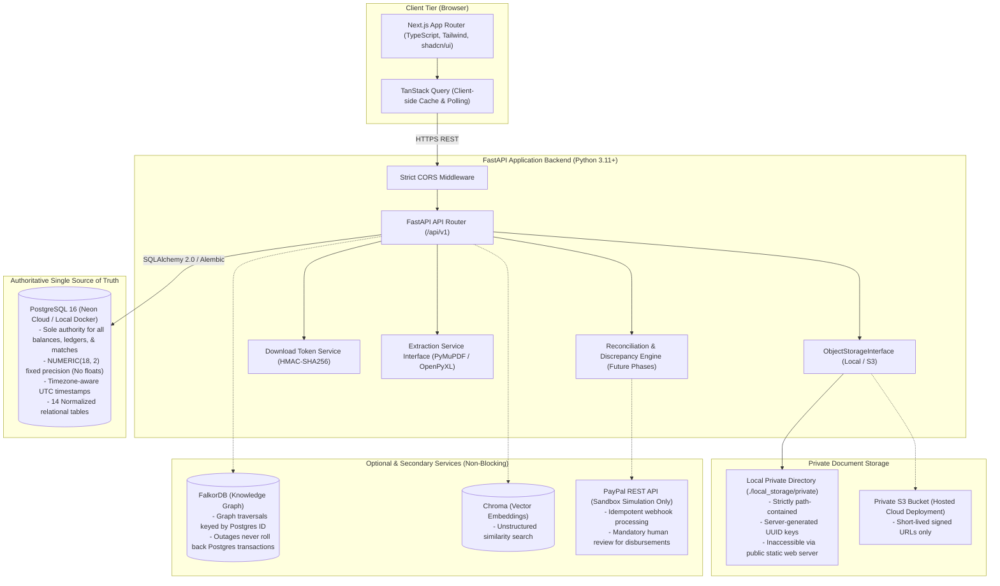

## Grounded AI Investigation & Reconciliation Explanations (Canonical Phase 6)

The feature exposes `POST /api/v1/transactions/{id}/investigate`. The path resolver accepts either
the transaction UUID or its case-insensitive human-readable reference, then the service canonicalizes
to the PostgreSQL UUID before querying child records. An optional discrepancy ID must belong to the
same transaction or the request fails with HTTP 400.

```mermaid
sequenceDiagram
    autonumber
    actor Reviewer as Human Reviewer
    participant UI as Payments / Investigation Panel
    participant API as FastAPI Investigation Route
    participant Service as Read-only Investigation Service
    participant DB as PostgreSQL (Source of Truth)
    participant LLM as Configured LLM Provider

    Reviewer->>UI: Ask about EXP-DEMO-004
    UI->>API: POST /transactions/{reference}/investigate
    API->>Service: Resolve reference; validate request
    Service->>DB: SELECT transaction-scoped invoices, payments, matches, discrepancies, evidence
    DB-->>Service: Persisted records only
    Service->>Service: Build exact financial facts + valid citation ID set
    Service->>LLM: Send minimized JSON context and question
    LLM-->>Service: Structured candidate explanation
    Service->>Service: Pydantic validation; filter unrecognized citation UUIDs
    Service-->>API: Facts + explanation + warnings; requires_human_review=true
    API-->>UI: Read-only investigation result
    UI-->>Reviewer: Show sources, financial facts, missing information, and optional draft
```

### Phase 6 boundaries

- PostgreSQL remains the only authority for amounts, currencies, transaction state, and reconciliation
  verdicts. The model supplies explanatory text only; financial facts are assembled from persisted
  records and existing Phase 4 results.
- All database reads are filtered by the canonical transaction ID. Model citation IDs are retained
  only when they are UUIDs in that request's context. Free text from persisted records is untrusted
  data, never instructions.
- Monetary facts preserve the currency attached to the source invoice, payment, fee, net proceeds, or
  discrepancy calculation. Cross-currency values are not subtracted. The response identifies the
  mismatch for reviewer attention.
- The service performs no database writes and cannot approve/reject matches, mutate balances, create
  allocations, initiate PayPal actions, or send clarification drafts. Every response requires a
  human reviewer. Requests for unauthorized actions are refused.
- Provider configuration comes from backend environment variables. Gemini uses the REST API through
  `httpx`; the API key is sent in a header. Missing keys, timeouts, HTTP failures, or invalid output
  return a safe unavailable response. Logs contain transaction IDs and error classes, never provider
  response bodies, prompts, keys, or full document text.
- Automated tests inject deterministic mocked providers. They verify isolation, ownership checks,
  refusal handling, citation filtering, currency labeling, failure fallback, and unchanged persisted
  rows. No live LLM or PayPal call is part of automated verification.

---

## 2. Normalized Relational Domain Model (Entity-Relationship Diagram)

PostgreSQL is the single source of truth. Every financial amount uses `NUMERIC(18, 2)` accompanied by an explicit uppercase 3-letter ISO-4217 currency code. All primary keys use native `UUIDv4`.

```mermaid
erDiagram
    Document ||--o{ ExtractedField : "contains"
    Document ||--o{ EvidenceReference : "source_document"
    Document ||--o{ Invoice : "source_file"
    Document ||--o{ ShippingBill : "source_file"
    
    ExportTransaction ||--o{ Invoice : "covers"
    ExportTransaction ||--o{ ShippingBill : "declares"
    ExportTransaction ||--o{ Payment : "receives"
    ExportTransaction ||--o{ Settlement : "settles"
    ExportTransaction ||--o{ BankTransaction : "deposits"
    ExportTransaction ||--o{ TransactionLink : "scopes"
    Invoice ||--o{ InvoiceLineItem : "contains"
    Invoice ||--o{ Payment : "receives"
    
    Settlement ||--o{ Payment : "batches"
    BankTransaction ||--o{ Settlement : "settles"
    
    Payment ||--o{ ProviderWebhookEvent : "triggers"
    Payment ||--o| Payment : "refunds_parent"
    
    TransactionLink ||--o| Invoice : "invoice_id"
    TransactionLink ||--o| ShippingBill : "shipping_bill_id"
    TransactionLink ||--o| Payment : "payment_id"
    TransactionLink ||--o| Settlement : "settlement_id"
    TransactionLink ||--o| BankTransaction : "bank_transaction_id"
    TransactionLink ||--o{ EvidenceReference : "supported_by"
    TransactionLink ||--o{ HumanDecision : "decided_by"

    Invoice ||--o{ Allocation : "settled_by"
    Payment ||--o{ Allocation : "allocates_from"
    Settlement ||--o{ Allocation : "allocates_from"
    BankTransaction ||--o{ Allocation : "allocates_from"
    
    Discrepancy ||--o{ EvidenceReference : "supported_by"
    Allocation ||--o{ EvidenceReference : "supported_by"
    EvidenceReference }o--|| TransactionLink : "proves"
    
    Discrepancy ||--o{ HumanDecision : "adjudicated_by"
    Allocation ||--o{ HumanDecision : "adjudicated_by"

    Document {
        uuid id PK
        string original_filename
        string media_type
        bigint size_bytes
        string sha256 UK
        string storage_key
        string document_type
        timestamptz upload_time
        string processing_status
        int page_count
        boolean is_demo
    }

    ExtractedField {
        uuid id PK
        uuid document_id FK
        string field_name
        text raw_value
        json normalized_value
        int page_number
        int row_number
        json bounding_box
        numeric confidence
        string review_state
        string extraction_method
        string reviewed_by
        timestamptz reviewed_at
    }

    ExportTransaction {
        uuid id PK
        string transaction_reference UK
        string exporter_name
        string exporter_tax_id
        string buyer_name
        string buyer_country
        string status
        boolean is_demo
    }

    Invoice {
        uuid id PK
        string invoice_number
        uuid export_transaction_id FK
        uuid document_id FK
        string seller_name
        string buyer_name
        date issue_date
        string currency
        numeric total_amount
        string shipment_reference
        boolean is_demo
    }

    InvoiceLineItem {
        uuid id PK
        uuid invoice_id FK
        int line_number
        string description
        numeric quantity
        numeric unit_price
        numeric total_amount
        string currency
        string hs_code
    }

    ShippingBill {
        uuid id PK
        string shipping_bill_number UK
        uuid export_transaction_id FK
        uuid document_id FK
        string invoice_reference
        string exporter_name
        string buyer_name
        date bill_date
        string declared_currency
        numeric declared_value
        boolean is_demo
    }

    BankTransaction {
        uuid id PK
        uuid export_transaction_id FK
        string bank_reference UK
        string currency
        numeric amount
        date transaction_date
        string transaction_type
        string status
        string remittance_reference
        boolean is_demo
    }

    Settlement {
        uuid id PK
        uuid export_transaction_id FK
        string provider_reference UK
        uuid bank_transaction_id FK
        string currency
        numeric amount
        date settlement_date
        string status
        string remittance_reference
        boolean is_demo
    }

    Payment {
        uuid id PK
        uuid export_transaction_id FK
        uuid invoice_id FK
        string provider
        uuid settlement_id FK
        string provider_order_id
        string provider_capture_id UK
        string provider_refund_id UK
        uuid parent_payment_id FK
        string invoice_reference
        string currency
        numeric gross_amount
        numeric fee_amount
        numeric net_amount
        string description
        string status
        timestamptz event_time
        string environment
        boolean is_demo
    }

    ProviderWebhookEvent {
        uuid id PK
        string provider
        string provider_event_id UK
        string event_type
        uuid payment_id FK
        json payload
        string status
        timestamptz event_time
    }

    Allocation {
        uuid id PK
        uuid invoice_id FK
        uuid payment_id FK
        uuid settlement_id FK
        uuid bank_transaction_id FK
        numeric allocated_amount
        string currency
        string allocation_method
        text evidence_notes
        string review_status
        boolean is_demo
    }

    Discrepancy {
        uuid id PK
        string rule_id
        string severity
        json compared_fields
        text description
        text recommended_action
        string status
        boolean is_demo
    }

    HumanDecision {
        uuid id PK
        string target_type
        uuid target_id
        string decision
        string reviewer_label
        text notes
        timestamptz decided_at
    }

    EvidenceReference {
        uuid id PK
        uuid discrepancy_id FK
        uuid allocation_id FK
        uuid transaction_link_id FK
        uuid document_id FK
        uuid extracted_field_id FK
        string source_record_type
        uuid source_record_id
        string original_filename
        string location_reference
        json bounding_box
        text raw_value
        text normalized_value
        string extraction_method
        string review_state
    }

    TransactionLink {
        uuid id PK
        uuid export_transaction_id FK
        string link_type
        string link_method
        string status
        uuid invoice_id FK
        uuid shipping_bill_id FK
        uuid payment_id FK
        uuid settlement_id FK
        uuid bank_transaction_id FK
        string explicit_reference
        string normalized_reference
        text evidence_notes
        boolean is_demo
    }
```

---

## 3. Financial Proceeds Pipeline & Allocation Architecture

The proceeds pipeline represents the lifecycle of funds received through payment providers and banking channels:

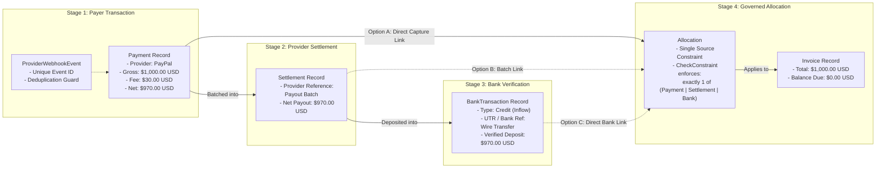

---

## 4. Document Ingestion, Security & Storage Pipeline

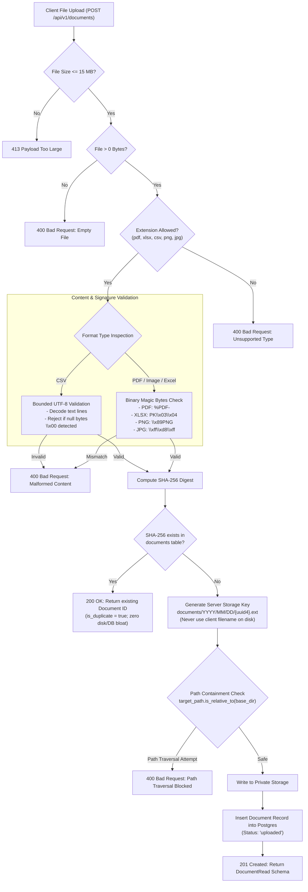

---

## 5. Short-Lived Download Token & File Retrieval Flow

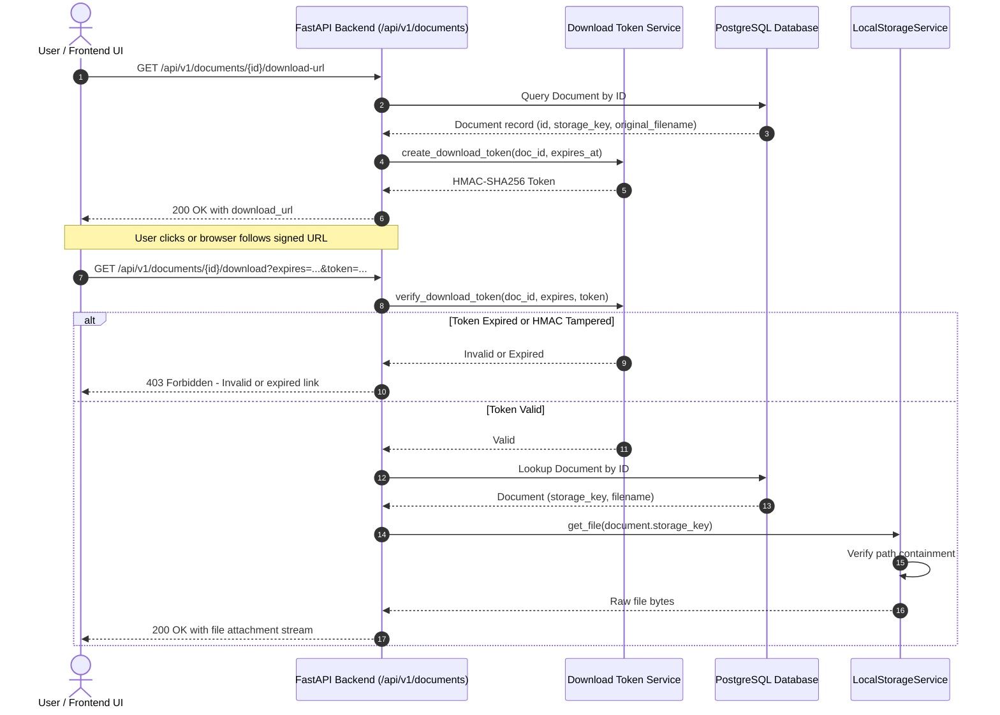

---

## 6. Transaction Relationships & Link Discovery Architecture (Phase 3)

Phase 3 establishes typed, verifiable relationships connecting commercial invoices, customs shipping bills, payment captures, provider payout settlements, and bank statement credits strictly within PostgreSQL (deferring FalkorDB entirely).

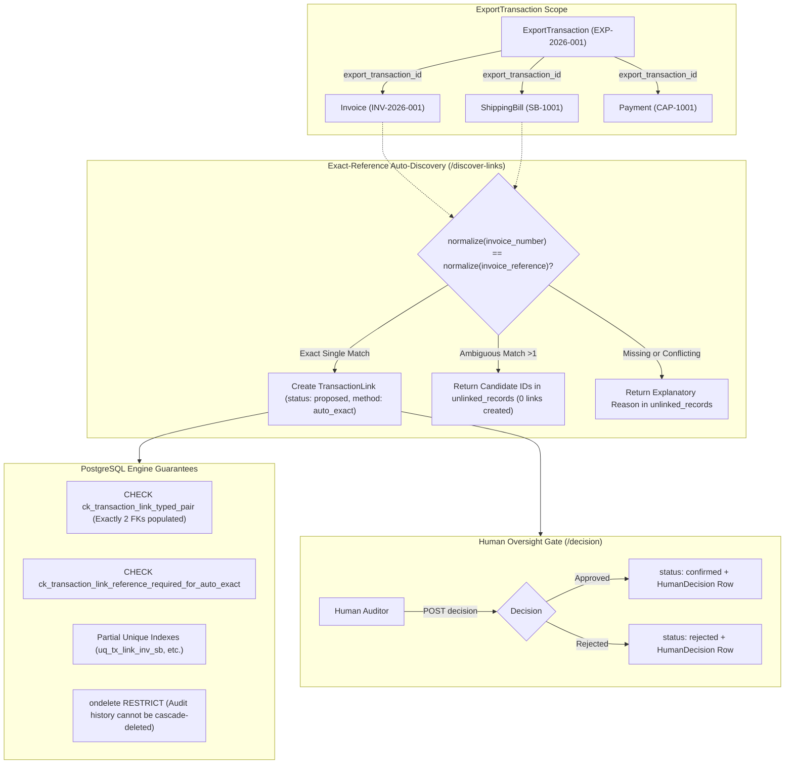

### Relationship Discovery & Human Decision Sequence Flow

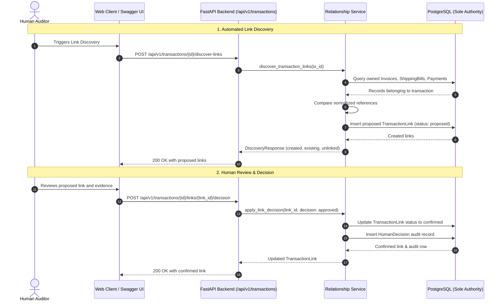

---

## 7. End-to-End Trade Lifecycle Sequence

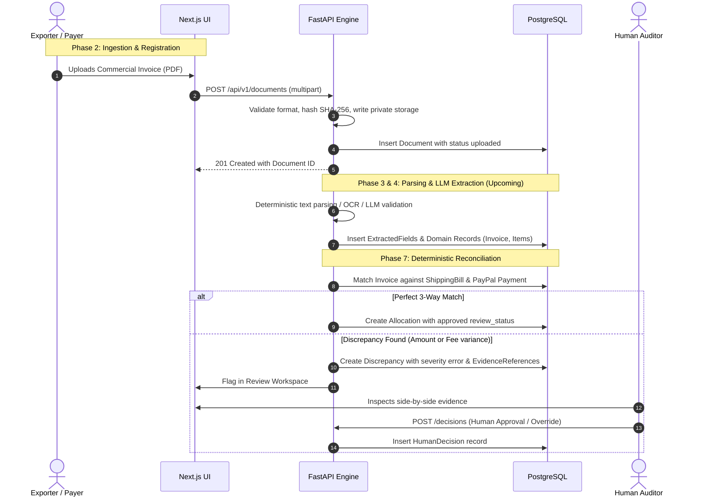

---

## 8. PayPal Sandbox Checkout & Verified Ingestion Architecture (Phase 5)

Phase 5 implements a functional, production-grade checkout and payment-event ingestion integration strictly bound to the **PayPal Sandbox environment**. In compliance with core architectural rules, money movement requires mandatory human auditor approval, payment orders are strictly bound to stored database invoices, and webhook events are deduplicated at the database tier.

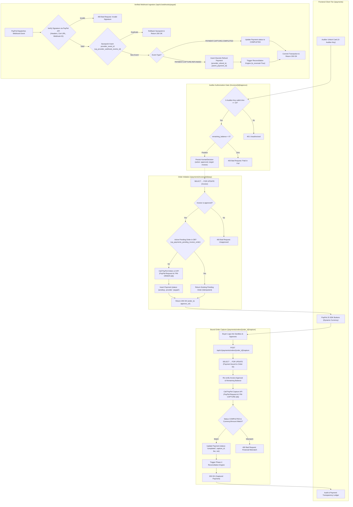

### 8.1 Core Architectural & Security Rules

1. **Strict Sandbox Containment**:
   - `PAYPAL_BASE_URL` is validated using Python's `urlparse`. Scheme must be `https`, and hostname is strictly restricted to `api-m.sandbox.paypal.com` or `api.sandbox.paypal.com`. Subpaths, query strings, fragments, userinfo, and custom ports are rejected at startup.
   - `PAYPAL_ENVIRONMENT` must strictly equal `"sandbox"`. Live production environments and URLs are rejected by Pydantic validation.
   - Client secrets are never returned in HTTP responses or exposed to the frontend.

2. **Auditor Authorization Gate**:
   - `AUDITOR_API_KEY` is loaded from the environment and must be at least 16 characters long.
   - `POST /api/v1/invoices/{invoice_id}/approve` checks the `X-Auditor-Key` header via constant-time comparison (`secrets.compare_digest`), inserting an immutable `HumanDecision` record.
   - Invoices cannot be paid unless `is_approved == True` and `remaining_balance > 0`.

3. **Pending Order Idempotency**:
   - Database partial unique index `uq_payments_pending_invoice_order` on `payments(invoice_id)` where `status in ('pending', 'PENDING') AND provider = 'paypal'`.
   - Repeated calls to `/pay` return the existing pending order without creating redundant PayPal orders.
   - All outgoing PayPal order creation calls pass `PayPal-Request-Id: PM-ORDER-{invoice_id}`.

4. **Bound Capture Verification**:
   - Capture requests lock the associated `Payment` row using `SELECT ... FOR UPDATE`.
   - Re-verifies that the payment is linked to an approved invoice and the captured gross amount and currency match the stored order before marking as `completed`.
   - Captures are made idempotent using `PayPal-Request-Id: PM-CAPTURE-{order_id}`.

5. **Discrete Refund Modeling**:
   - Refunds from `PAYMENT.CAPTURE.REFUNDED` are stored as distinct `Payment` records populated with `provider_refund_id` and linked to the original capture via `parent_payment_id`.
   - Captures are never overwritten. A compensating reversal is passed to the Phase 4 reconciliation engine, proposing a reversal allocation for human auditor review.

6. **Database Webhook Deduplication & Atomic Commitment**:
   - Webhook events are checked against the unique constraint `provider_event_id` using nested database savepoints (`db.begin_nested()`).
   - Duplicate deliveries are acknowledged immediately with `200 OK` without side effects.
   - Responses are returned only after the event record, payment update, and reconciliation trigger are successfully committed.

---

### 8.2 Sequence Flows

#### Sequence 1: Auditor Approval & Sandbox Checkout Flow

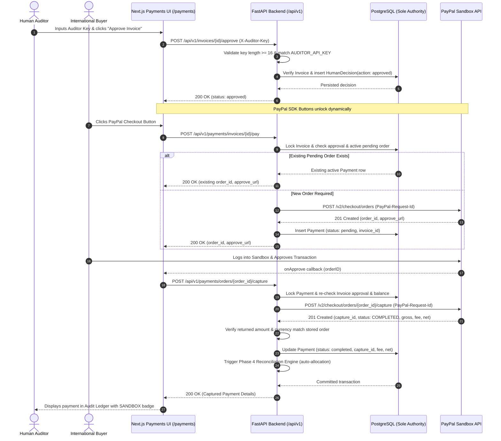

#### Sequence 2: Webhook Ingestion & Refund Reversal Flow

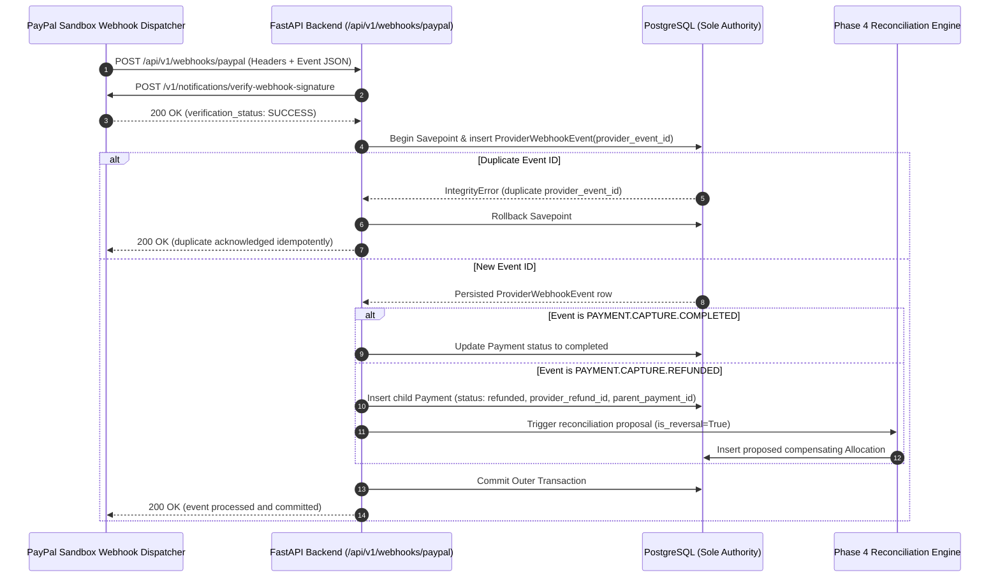

