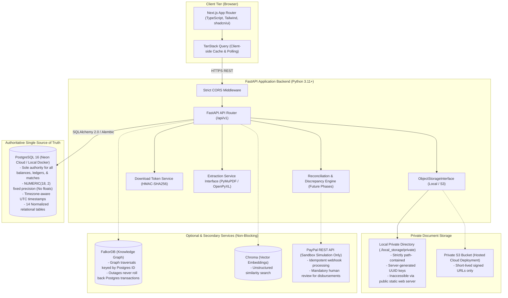
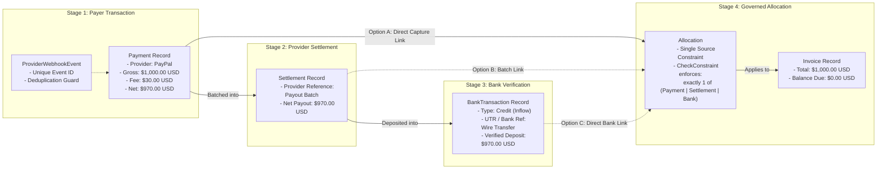
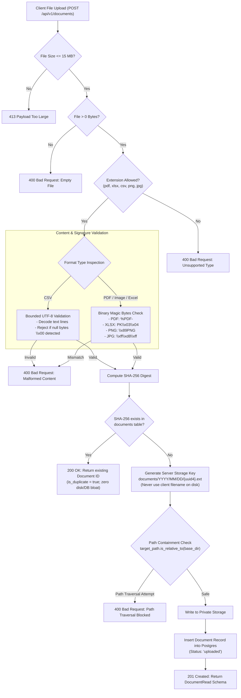
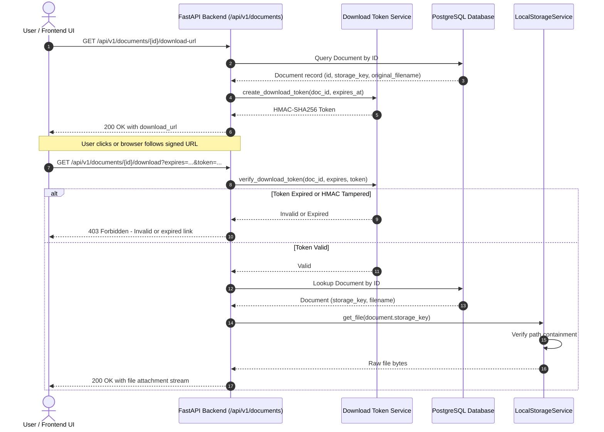
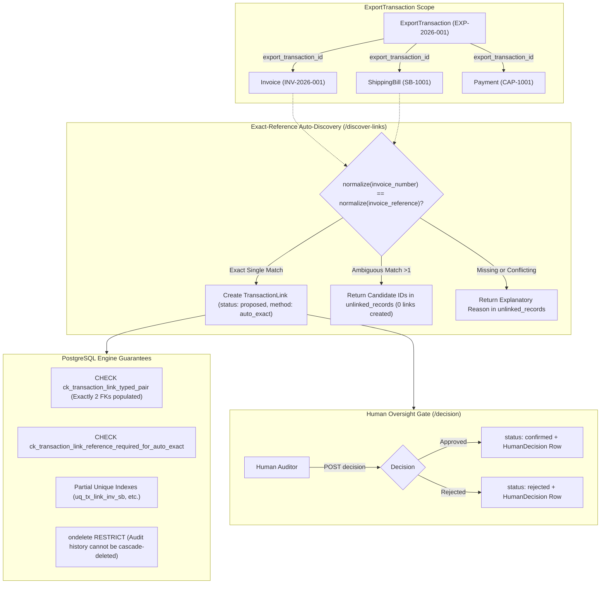
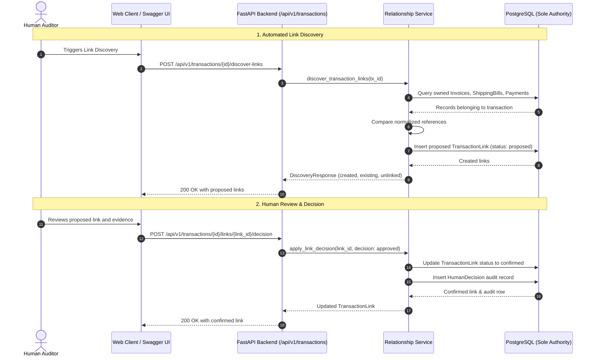
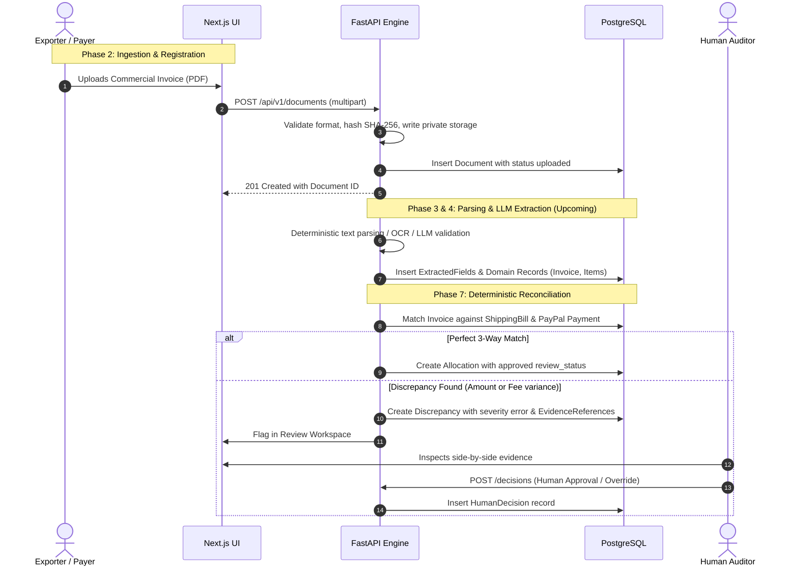

# ProcureMind: Technical Architecture Reference

ProcureMind is an autonomous financial reconciliation engine designed for international trade, three-way document matching, automated discrepancy resolution, and governed sandbox disbursements.

This document serves as the persistent technical architecture reference for all data models, security boundaries, and operational pipelines.

---

## 1. High-Level System Architecture

---

## 2. Normalized Relational Domain Model (Entity-Relationship Diagram)

PostgreSQL is the single source of truth. Every financial amount uses `NUMERIC(18, 2)` accompanied by an explicit uppercase 3-letter ISO-4217 currency code. All primary keys use native `UUIDv4`.

```mermaid
erDiagram
    Document ||--o{ ExtractedField : "contains"
    Document ||--o{ EvidenceReference : "source_document"
    Document ||--o{ Invoice : "source_file"
    Document ||--o{ ShippingBill : "source_file"
    
    ExportTransaction ||--o{ Invoice : "covers"
    ExportTransaction ||--o{ ShippingBill : "declares"
    ExportTransaction ||--o{ Payment : "receives"
    ExportTransaction ||--o{ Settlement : "settles"
    ExportTransaction ||--o{ BankTransaction : "deposits"
    ExportTransaction ||--o{ TransactionLink : "scopes"
    Invoice ||--o{ InvoiceLineItem : "contains"
    
    Settlement ||--o{ Payment : "batches"
    BankTransaction ||--o{ Settlement : "settles"
    
    Payment ||--o{ ProviderWebhookEvent : "triggers"
    
    TransactionLink ||--o| Invoice : "invoice_id"
    TransactionLink ||--o| ShippingBill : "shipping_bill_id"
    TransactionLink ||--o| Payment : "payment_id"
    TransactionLink ||--o| Settlement : "settlement_id"
    TransactionLink ||--o| BankTransaction : "bank_transaction_id"
    TransactionLink ||--o{ EvidenceReference : "supported_by"
    TransactionLink ||--o{ HumanDecision : "decided_by"

    Invoice ||--o{ Allocation : "settled_by"
    Payment ||--o{ Allocation : "allocates_from"
    Settlement ||--o{ Allocation : "allocates_from"
    BankTransaction ||--o{ Allocation : "allocates_from"
    
    Discrepancy ||--o{ EvidenceReference : "supported_by"
    Allocation ||--o{ EvidenceReference : "supported_by"
    EvidenceReference }o--|| TransactionLink : "proves"
    
    Discrepancy ||--o{ HumanDecision : "adjudicated_by"
    Allocation ||--o{ HumanDecision : "adjudicated_by"

    Document {
        uuid id PK
        string original_filename
        string media_type
        bigint size_bytes
        string sha256 UK
        string storage_key
        string document_type
        timestamptz upload_time
        string processing_status
        int page_count
        boolean is_demo
    }

    ExtractedField {
        uuid id PK
        uuid document_id FK
        string field_name
        text raw_value
        json normalized_value
        int page_number
        int row_number
        json bounding_box
        numeric confidence
        string review_state
        string extraction_method
        string reviewed_by
        timestamptz reviewed_at
    }

    ExportTransaction {
        uuid id PK
        string transaction_reference UK
        string exporter_name
        string exporter_tax_id
        string buyer_name
        string buyer_country
        string status
        boolean is_demo
    }

    Invoice {
        uuid id PK
        string invoice_number
        uuid export_transaction_id FK
        uuid document_id FK
        string seller_name
        string buyer_name
        date issue_date
        string currency
        numeric total_amount
        string shipment_reference
        boolean is_demo
    }

    InvoiceLineItem {
        uuid id PK
        uuid invoice_id FK
        int line_number
        string description
        numeric quantity
        numeric unit_price
        numeric total_amount
        string currency
        string hs_code
    }

    ShippingBill {
        uuid id PK
        string shipping_bill_number UK
        uuid export_transaction_id FK
        uuid document_id FK
        string invoice_reference
        string exporter_name
        string buyer_name
        date bill_date
        string declared_currency
        numeric declared_value
        boolean is_demo
    }

    BankTransaction {
        uuid id PK
        uuid export_transaction_id FK
        string bank_reference UK
        string currency
        numeric amount
        date transaction_date
        string transaction_type
        string status
        string remittance_reference
        boolean is_demo
    }

    Settlement {
        uuid id PK
        uuid export_transaction_id FK
        string provider_reference UK
        uuid bank_transaction_id FK
        string currency
        numeric amount
        date settlement_date
        string status
        string remittance_reference
        boolean is_demo
    }

    Payment {
        uuid id PK
        uuid export_transaction_id FK
        string provider
        uuid settlement_id FK
        string provider_order_id
        string provider_capture_id UK
        string invoice_reference
        string currency
        numeric gross_amount
        numeric fee_amount
        numeric net_amount
        string status
        timestamptz event_time
        string environment
        boolean is_demo
    }

    ProviderWebhookEvent {
        uuid id PK
        string provider
        string provider_event_id UK
        string event_type
        uuid payment_id FK
        json payload
        string status
        timestamptz event_time
    }

    Allocation {
        uuid id PK
        uuid invoice_id FK
        uuid payment_id FK
        uuid settlement_id FK
        uuid bank_transaction_id FK
        numeric allocated_amount
        string currency
        string allocation_method
        text evidence_notes
        string review_status
        boolean is_demo
    }

    Discrepancy {
        uuid id PK
        string rule_id
        string severity
        json compared_fields
        text description
        text recommended_action
        string status
        boolean is_demo
    }

    HumanDecision {
        uuid id PK
        string target_type
        uuid target_id
        string decision
        string reviewer_label
        text notes
        timestamptz decided_at
    }

    EvidenceReference {
        uuid id PK
        uuid discrepancy_id FK
        uuid allocation_id FK
        uuid transaction_link_id FK
        uuid document_id FK
        uuid extracted_field_id FK
        string source_record_type
        uuid source_record_id
        string original_filename
        string location_reference
        json bounding_box
        text raw_value
        text normalized_value
        string extraction_method
        string review_state
    }

    TransactionLink {
        uuid id PK
        uuid export_transaction_id FK
        string link_type
        string link_method
        string status
        uuid invoice_id FK
        uuid shipping_bill_id FK
        uuid payment_id FK
        uuid settlement_id FK
        uuid bank_transaction_id FK
        string explicit_reference
        string normalized_reference
        text evidence_notes
        boolean is_demo
    }
```

---

## 3. Financial Proceeds Pipeline & Allocation Architecture

The proceeds pipeline represents the lifecycle of funds received through payment providers and banking channels:

---

## 4. Document Ingestion, Security & Storage Pipeline

---

## 5. Short-Lived Download Token & File Retrieval Flow

---

## 6. Transaction Relationships & Link Discovery Architecture (Phase 3)

Phase 3 establishes typed, verifiable relationships connecting commercial invoices, customs shipping bills, payment captures, provider payout settlements, and bank statement credits strictly within PostgreSQL (deferring FalkorDB entirely).

### Relationship Discovery & Human Decision Sequence Flow

---

## 7. End-to-End Trade Lifecycle Sequence

